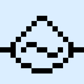

# Alternate Current

**Status:** No 26.3 build - **Upstream licence:** `MIT License` - **26.3 build:** `-` - [Modrinth](https://modrinth.com/mod/alternate-current)

## Where it stands

A redstone engine: world logic, which Horizon implements itself and no hook point reaches.

The upstream project has no build for Minecraft 26.3, the version Horizon implements. That does not stop a native port by itself; the reason it is not ported is on its page.

## Credit

Alternate Current belongs to Space Walker; see its Modrinth page. No code or text from it is copied here. The icon above is the project's own icon from Modrinth, by Space Walker, shown only to identify the mod; it is not covered by this repository's licence and comes down on request (see [DMCA and takedowns](../docs/dmca.md)).
Back to the [catalogue](../MODS.md).
