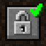

# Auth Me

**Status:** Built into Horizon - **Upstream licence:** `MIT License` - **26.3 build:** `authme-fabric-9.3.0+26.3` - [Modrinth](https://modrinth.com/mod/auth-me)

## Where it stands

Horizon has its own account sign-in (a device-code sign-in in its settings).

Horizon already does this itself, so a mod would only duplicate it.

## Credit

Auth Me belongs to axieum; see its Modrinth page. No code or text from it is copied here. The icon above is the project's own icon from Modrinth, by axieum, shown only to identify the mod; it is not covered by this repository's licence and comes down on request (see [DMCA and takedowns](../docs/dmca.md)).
Back to the [catalogue](../MODS.md).
