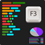

# BetterF3

**Status:** Partly ported - **Upstream licence:** `MIT License` - **26.3 build:** `-` - [Modrinth](https://modrinth.com/mod/betterf3)

**Project:** [`custom-hud`](../mods/custom-hud/) - [docs](../docs/mods/custom-hud.md)

## Where it stands

A readable, switchable HUD of FPS, coordinates, facing and clicks per second in Custom HUD, and speed and angles in Info HUD; it does not replace the F3 screen

Only part of this fits the hook points; see the project for what is in and what is missing.

## Credit

BetterF3 belongs to TreyRuffy, cominixo; see its Modrinth page. No code or text from it is copied here. The icon above is the project's own icon from Modrinth, by TreyRuffy, cominixo, shown only to identify the mod; it is not covered by this repository's licence and comes down on request (see [DMCA and takedowns](../docs/dmca.md)).
Back to the [catalogue](../MODS.md).
