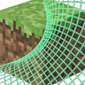

# BetterGrassify

**Status:** Needs a hook point - **Upstream licence:** `Apache-2.0` - **26.3 build:** `1.8.8+fabric.26.3` - [Modrinth](https://modrinth.com/mod/bettergrassify)

## Where it stands

Swaps a grass block's side texture for its top texture next to other grass. Horizon's mesher (`mesher.rs`, `Mesher::face`) draws a face from a texture layer that a rebuilt `face` could swap, but the result cannot be seen or checked here. Not attempted.

A port needs data or a hook that Horizon's stable hook points do not give a mod. It can still be written as a raw-hook port pinned to one Horizon commit; that is tracked in the roadmap.

## Credit

BetterGrassify belongs to UltimatChamp, JayemCeekay; see its Modrinth page. No code or text from it is copied here. The icon above is the project's own icon from Modrinth, by UltimatChamp, JayemCeekay, shown only to identify the mod; it is not covered by this repository's licence and comes down on request (see [DMCA and takedowns](../docs/dmca.md)).
Back to the [catalogue](../MODS.md).
