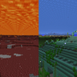

# Clear Water/Lava/PowderSnow

**Status:** Pack or asset - **Upstream licence:** `see project` - **26.3 build:** `ClearWaterLava-Fabric-26.3` - [Modrinth](https://modrinth.com/mod/clear-waterlavapowdersnow)

## Where it stands

Resource-pack, shader or rendering-asset territory: the registry lists those as packs, not native mods.

This is a resource pack, shader, theme or model asset. The Horizon registry lists those as packs, not native mods, so there is no Rust to write.

## Credit

Clear Water/Lava/PowderSnow belongs to n8-M4x; see its Modrinth page. No code or text from it is copied here. The icon above is the project's own icon from Modrinth, by n8-M4x, shown only to identify the mod; it is not covered by this repository's licence and comes down on request (see [DMCA and takedowns](../docs/dmca.md)).
Back to the [catalogue](../MODS.md).
