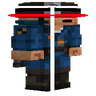

# Combat Hitboxes

**Status:** Ported - **Upstream licence:** `Apache License 2.0` - **26.3 build:** `combat-hitbox-1.0.11` - [Modrinth](https://modrinth.com/mod/combat-hitboxes)

**Project:** [`combat-hitboxes`](../mods/combat-hitboxes/) - [docs](../docs/mods/combat-hitboxes.md)

## Where it stands

Combat Hitboxes (raw-hook port: wraps the ray-versus-box test)

Ported: a project in this repository re-implements it.

## Credit

Combat Hitboxes belongs to sootysplash; see its Modrinth page. No code or text from it is copied here. The icon above is the project's own icon from Modrinth, by sootysplash, shown only to identify the mod; it is not covered by this repository's licence and comes down on request (see [DMCA and takedowns](../docs/dmca.md)).
Back to the [catalogue](../MODS.md).
