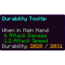

# Durability Tooltip

**Status:** Ported - **Upstream licence:** `see project` - **26.3 build:** `durabilitytooltip-1.2.0-fabric-mc26.3` - [Modrinth](https://modrinth.com/mod/durability-tooltip)

**Project:** [`durability-tooltip`](../mods/durability-tooltip/) - [docs](../docs/mods/durability-tooltip.md)

## Where it stands

Durability Tooltip (raw-hook port: returns from stack_tooltip)

Ported: a project in this repository re-implements it.

## Credit

Durability Tooltip belongs to SuperMartijn642; see its Modrinth page. No code or text from it is copied here. The icon above is the project's own icon from Modrinth, by SuperMartijn642, shown only to identify the mod; it is not covered by this repository's licence and comes down on request (see [DMCA and takedowns](../docs/dmca.md)).
Back to the [catalogue](../MODS.md).
