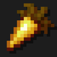

# Eating Animation

**Status:** Pack or asset - **Upstream licence:** `Creative Commons Attribution 4.0 International` - **26.3 build:** `Eating Animation[1.0.1]` - [Modrinth](https://modrinth.com/mod/eating-animation-resourcepack)

## Where it stands

Resource-pack, shader or rendering-asset territory: the registry lists those as packs, not native mods.

This is a resource pack, shader, theme or model asset. The Horizon registry lists those as packs, not native mods, so there is no Rust to write.

## Credit

Eating Animation belongs to ThatCuteOne; see its Modrinth page. No code or text from it is copied here. The icon above is the project's own icon from Modrinth, by ThatCuteOne, shown only to identify the mod; it is not covered by this repository's licence and comes down on request (see [DMCA and takedowns](../docs/dmca.md)).
Back to the [catalogue](../MODS.md).
