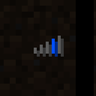

# Fast IP Ping

**Status:** Engine or server - **Upstream licence:** `GNU Lesser General Public License v3.0 only` - **26.3 build:** `fast-ip-ping-v1.0.12-mc26.3` - [Modrinth](https://modrinth.com/mod/fast-ip-ping)

## Where it stands

Performance, server or engine work. Horizon is a native rewrite, so the engine already does its own.

This changes how the game engine performs or how a server runs. Horizon is a native rewrite with its own engine, so there is nothing to patch in.

## Credit

Fast IP Ping belongs to fallen-breath; see its Modrinth page. No code or text from it is copied here. The icon above is the project's own icon from Modrinth, by fallen-breath, shown only to identify the mod; it is not covered by this repository's licence and comes down on request (see [DMCA and takedowns](../docs/dmca.md)).
Back to the [catalogue](../MODS.md).
