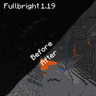

# Fullbright

**Status:** Built into Horizon - **Upstream licence:** `GPL-3.0-only` - **26.3 build:** `-` - [Modrinth](https://modrinth.com/mod/fullbright)

## Where it stands

Horizon has a Fullbright extra of its own.

Horizon already does this itself, so a mod would only duplicate it.

## Credit

Fullbright belongs to greeenman999; see its Modrinth page. No code or text from it is copied here. The icon above is the project's own icon from Modrinth, by greeenman999, shown only to identify the mod; it is not covered by this repository's licence and comes down on request (see [DMCA and takedowns](../docs/dmca.md)).
Back to the [catalogue](../MODS.md).
