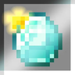

# Item Highlighter

**Status:** Ported - **Upstream licence:** `CC-BY-NC-ND-4.0` - **26.3 build:** `1.2.3` - [Modrinth](https://modrinth.com/mod/item-highlighter)

**Project:** [`item-highlighter`](../mods/item-highlighter/) - [docs](../docs/mods/item-highlighter.md)

## Where it stands

A twinkling star on slots holding items picked up since the inventory was last closed

Ported: a project in this repository re-implements it.

## Credit

Item Highlighter belongs to Grend, Mat0u5; see its Modrinth page. No code or text from it is copied here. The icon above is the project's own icon from Modrinth, by Grend, Mat0u5, shown only to identify the mod; it is not covered by this repository's licence and comes down on request (see [DMCA and takedowns](../docs/dmca.md)).
Back to the [catalogue](../MODS.md).
