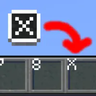

# Key Overlay

**Status:** Ported - **Upstream licence:** `see project` - **26.3 build:** `KeyOverlay-26.3` - [Modrinth](https://modrinth.com/mod/keyoverlay)

**Project:** [`key-overlay`](../mods/key-overlay/) - [docs](../docs/mods/key-overlay.md)

## Where it stands

Key Overlay

Ported: a project in this repository re-implements it.

## Credit

Key Overlay belongs to Seyit; see its Modrinth page. No code or text from it is copied here. The icon above is the project's own icon from Modrinth, by Seyit, shown only to identify the mod; it is not covered by this repository's licence and comes down on request (see [DMCA and takedowns](../docs/dmca.md)).
Back to the [catalogue](../MODS.md).
