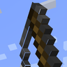

# Model Gap Fix

**Status:** No 26.3 build - **Upstream licence:** `GPL-3.0-only` - **26.3 build:** `-` - [Modrinth](https://modrinth.com/mod/modelfix)

## Where it stands

No Fabric build for 26.3, the game version Horizon implements.

The upstream project has no build for Minecraft 26.3, the version Horizon implements, so there is no reference behaviour to port yet.

## Credit

Model Gap Fix belongs to MehVahdJukaar; see its Modrinth page. No code or text from it is copied here. The icon above is the project's own icon from Modrinth, by MehVahdJukaar, shown only to identify the mod; it is not covered by this repository's licence and comes down on request (see [DMCA and takedowns](../docs/dmca.md)).
Back to the [catalogue](../MODS.md).
