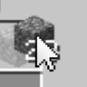

# Mouse Tweaks

**Status:** Needs a hook point - **Upstream licence:** `BSD 3-Clause "New" or "Revised" License` - **26.3 build:** `MouseTweaks-fabric-mc26.3-2.31` - [Modrinth](https://modrinth.com/mod/mouse-tweaks)

## Where it stands

Needs input or camera hooks that Horizon does not expose yet.

A port needs data or a hook that Horizon's stable hook points do not give a mod. It can still be written as a raw-hook port pinned to one Horizon commit; that is tracked in the roadmap.

## Credit

Mouse Tweaks belongs to YaLTeR; see its Modrinth page. No code or text from it is copied here. The icon above is the project's own icon from Modrinth, by YaLTeR, shown only to identify the mod; it is not covered by this repository's licence and comes down on request (see [DMCA and takedowns](../docs/dmca.md)).
Back to the [catalogue](../MODS.md).
