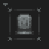

# No Death Animation

**Status:** Ported - **Upstream licence:** `MIT` - **26.3 build:** `-` - [Modrinth](https://modrinth.com/mod/no-death-animation)

**Project:** [`better-hurt-cam`](../mods/better-hurt-cam/) - [docs](../docs/mods/better-hurt-cam.md)

## Where it stands

The death tilt can be switched off in Better Hurt Cam

Ported: a project in this repository re-implements it.

## Credit

No Death Animation belongs to Walksy, OutcastMaya; see its Modrinth page. No code or text from it is copied here. The icon above is the project's own icon from Modrinth, by Walksy, OutcastMaya, shown only to identify the mod; it is not covered by this repository's licence and comes down on request (see [DMCA and takedowns](../docs/dmca.md)).
Back to the [catalogue](../MODS.md).
