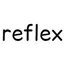

# Reflex AntiLag

**Status:** No 26.3 build - **Upstream licence:** `see project` - **26.3 build:** `-` - [Modrinth](https://modrinth.com/mod/reflex-antilag)

## Where it stands

NVIDIA Reflex latency control through the GPU driver; Horizon renders with wgpu.

The upstream project has no build for Minecraft 26.3, the version Horizon implements. That does not stop a native port by itself; the reason it is not ported is on its page.

## Credit

Reflex AntiLag belongs to Tythee; see its Modrinth page. No code or text from it is copied here. The icon above is the project's own icon from Modrinth, by Tythee, shown only to identify the mod; it is not covered by this repository's licence and comes down on request (see [DMCA and takedowns](../docs/dmca.md)).
Back to the [catalogue](../MODS.md).
