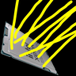

# ScalableLux

**Status:** Needs a hook point - **Upstream licence:** `GNU Lesser General Public License v3.0 only` - **26.3 build:** `ScalableLux-fabric-mc26.3-0.3.0-alpha.0.6-all` - [Modrinth](https://modrinth.com/mod/scalablelux)

## Where it stands

Needs a hook point Horizon does not have yet (the current hook points are listed in the docs).

A port needs data or a hook that Horizon's stable hook points do not give a mod. It can still be written as a raw-hook port pinned to one Horizon commit; that is tracked in the roadmap.

## Credit

ScalableLux belongs to ishland; see its Modrinth page. No code or text from it is copied here. The icon above is the project's own icon from Modrinth, by ishland, shown only to identify the mod; it is not covered by this repository's licence and comes down on request (see [DMCA and takedowns](../docs/dmca.md)).
Back to the [catalogue](../MODS.md).
