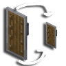

# Custom Shield Scale

**Status:** No 26.3 build - **Upstream licence:** `LicenseRef-All-Rights-Reserved` - **26.3 build:** `-` - [Modrinth](https://modrinth.com/mod/shieldscale)

## Where it stands

Scales the shield in the hand; the held-item transform has no hook.

The upstream project has no build for Minecraft 26.3, the version Horizon implements. That does not stop a native port by itself; the reason it is not ported is on its page.

## Credit

Custom Shield Scale belongs to cutebow; see its Modrinth page. No code or text from it is copied here. The icon above is the project's own icon from Modrinth, by cutebow, shown only to identify the mod; it is not covered by this repository's licence and comes down on request (see [DMCA and takedowns](../docs/dmca.md)).
Back to the [catalogue](../MODS.md).
