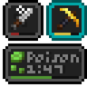

# Status Effect Bars

**Status:** Ported - **Upstream licence:** `GNU Lesser General Public License v3.0 only` - **26.3 build:** `status-effect-bars-1.0.12` - [Modrinth](https://modrinth.com/mod/status-effect-bars)

**Project:** [`effect-timer`](../mods/effect-timer/) - [docs](../docs/mods/effect-timer.md)

## Where it stands

Timer text and the duration bars under the effect icons

Ported: a project in this repository re-implements it.

## Credit

Status Effect Bars belongs to A5b84; see its Modrinth page. No code or text from it is copied here. The icon above is the project's own icon from Modrinth, by A5b84, shown only to identify the mod; it is not covered by this repository's licence and comes down on request (see [DMCA and takedowns](../docs/dmca.md)).
Back to the [catalogue](../MODS.md).
