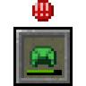

# uku's Armor HUD

**Status:** Needs a hook point - **Upstream licence:** `MIT License` - **26.3 build:** `ukus-armor-hud-fabric-0.13.0+mc26.3` - [Modrinth](https://modrinth.com/mod/ukus-armor-hud)

## Where it stands

Needs inventory, effect or item data that the hook points do not give a mod yet.

A port needs data or a hook that Horizon's stable hook points do not give a mod. It can still be written as a raw-hook port pinned to one Horizon commit; that is tracked in the roadmap.

## Credit

uku's Armor HUD belongs to uku; see its Modrinth page. No code or text from it is copied here. The icon above is the project's own icon from Modrinth, by uku, shown only to identify the mod; it is not covered by this repository's licence and comes down on request (see [DMCA and takedowns](../docs/dmca.md)).
Back to the [catalogue](../MODS.md).
