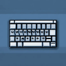

# VisualKeys

**Status:** Partly ported - **Upstream licence:** `see project` - **26.3 build:** `VisualKeys-0.0.11+26.3` - [Modrinth](https://modrinth.com/mod/visualkeys)

**Project:** [`visual-keys`](../mods/visual-keys/) - [docs](../docs/mods/visual-keys.md)

## Where it stands

The keyboard on the HUD with every key coloured by its binding, plus /keyboard free and /keyboard <key>; not inside the controls screen, no Malilib bindings, no category collapse

Only part of this fits the hook points; see the project for what is in and what is missing.

## Credit

VisualKeys belongs to DimasKama, KlashRaick; see its Modrinth page. No code or text from it is copied here. The icon above is the project's own icon from Modrinth, by DimasKama, KlashRaick, shown only to identify the mod; it is not covered by this repository's licence and comes down on request (see [DMCA and takedowns](../docs/dmca.md)).
Back to the [catalogue](../MODS.md).
