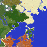

# Xaero's World Map

**Status:** Partly ported - **Upstream licence:** `see project` - **26.3 build:** `xaeroworldmap-fabric-26.3-1.46.4` - [Modrinth](https://modrinth.com/mod/xaeros-world-map)

**Project:** [`waypoints`](../mods/waypoints/) - [docs](../docs/mods/waypoints.md)

## Where it stands

Only the waypoints idea; there is no map screen hook yet.

Only part of this fits the hook points; see the project for what is in and what is missing.

## Credit

Xaero's World Map belongs to thexaero; see its Modrinth page. No code or text from it is copied here. The icon above is the project's own icon from Modrinth, by thexaero, shown only to identify the mod; it is not covered by this repository's licence and comes down on request (see [DMCA and takedowns](../docs/dmca.md)).
Back to the [catalogue](../MODS.md).
