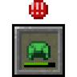

# Armor HUD

Your armor pieces and how much durability each has left, in a corner of the screen, and your armor value on the armor bar, with extra rows past 20 points.

**Version** 1.0.0 · **Game** 26.3 · **Pinned to Horizon ba6344a, reads game state** · **Licence** MIT · [Source](https://github.com/pxdns/horizon-mods-lib/tree/main/mods/armor-hud) · [Releases](https://github.com/pxdns/horizon-mods-lib/releases?q=armor-hud)

## Use it

| Command | What it does |
|---|---|
| `/armor` | Hides or shows Armor HUD |

| Option | Default |
|---|---|
| Shown | on |
| Show percent | on |
| Hide undamaged pieces | off |
| Armor value on the armor bar | on |

Switch it on or off in **Options → Mods → Armor HUD**; its settings page has one button per option. Install steps are in
[Install a mod](../install.md).

## How it is built

- Hooks: `native_hud`, `native_command`, `native_mods`, `native_settings`, `native_settings_click`.
- Logic and tests: `mods/armor-hud/mixins/armor_hud/runtime.rs`.
- Pinned: Horizon `ba6344a`, horizon-mixins `d9c83d7`. It reads fields of the game that are not part of the stable hook-point contract, so it must be re-checked when Horizon changes them.

## Credit

Ported from **uku's Armor HUD and Detail Armor Bar Reconstructed** (see the upstream projects); an independent implementation, with no upstream code or art. See [Credits](../credits.md)
and [Licensing](../licensing.md).
