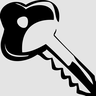

# Controlling

Find key bindings by action or by key, and list conflicts and unbound actions.

**Version** 1.0.0 · **Game** 26.3 · **Pinned to Horizon ba6344a, reads game state** · **Licence** MIT · [Source](https://github.com/pxdns/horizon-mods-lib/tree/main/mods/controlling) · [Releases](https://github.com/pxdns/horizon-mods-lib/releases?q=controlling)

## Use it

| Command | What it does |
|---|---|
| `/keybinds find <words>` | Bindings whose action name or key has all the words, with the key each is on |
| `/keybinds conflicts` | Keys that more than one action uses |
| `/keybinds unbound` | Actions with no key |
| `/keybinds` | Lists these |

Horizon's own Key Binds page already searches by action name; this finds by key too and lists conflicts.

| Option | Default |
|---|---|
| Leave out unbound actions from find | off |

Switch it on or off in **Options → Mods → Controlling**; its settings page has one button per option. Install steps are in
[Install a mod](../install.md).

## How it is built

- Hooks: `native_command`, `native_mods`, `native_settings`, `native_settings_click`.
- Logic and tests: `mods/controlling/mixins/controlling/runtime.rs`.
- Pinned: Horizon `ba6344a`, horizon-mixins `d9c83d7`. It reads fields of the game that are not part of the stable hook-point contract, so it must be re-checked when Horizon changes them.

## Credit

Ported from **Controlling (controlling)** (MIT); an independent implementation, with no upstream code or art. See [Credits](../credits.md)
and [Licensing](../licensing.md).
