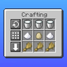

# Crafting Tweaks

Keys that rotate, balance and clear the crafting grid.

**Version** 1.0.0 · **Game** 26.3 · **Pinned to Horizon ba6344a, reads game state** · **Licence** MIT · [Source](https://github.com/pxdns/horizon-mods-lib/tree/main/mods/crafting-tweaks) · [Releases](https://github.com/pxdns/horizon-mods-lib/releases?q=crafting-tweaks)

## Use it

| Key | Default | What it does |
|---|---|---|
| Rotate | `]` | Turns the outer ring of the crafting grid one step clockwise |
| Balance | `[` | Evens out stacks of the same item across the grid (when they fit in one stack) |
| Clear | `\` | Moves everything in the grid back to your inventory |

Open your inventory or a crafting table and press the key. They work in single player and as a LAN host.

| Option | Default |
|---|---|
| Say in chat when an action cannot be done | on |

Switch it on or off in **Options → Mods → Crafting Tweaks**; its settings page has one button per option. Install steps are in
[Install a mod](../install.md).

## How it is built

- Hooks: `native_key`, `native_mods`, `native_settings`, `native_settings_click`.
- Logic and tests: `mods/crafting-tweaks/mixins/crafting_tweaks/runtime.rs`.
- Pinned: Horizon `ba6344a`, horizon-mixins `d9c83d7`. It reads fields of the game that are not part of the stable hook-point contract, so it must be re-checked when Horizon changes them.

## Credit

Ported from **Crafting Tweaks (craftingtweaks)** (independent implementation from the mod's public description; no upstream code or assets); an independent implementation, with no upstream code or art. See [Credits](../credits.md)
and [Licensing](../licensing.md).
