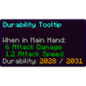

# Durability Tooltip

Adds a Durability line to the tooltip of tools, weapons and armor.

**Version** 1.0.0 · **Game** 26.3 · **Pinned to Horizon ba6344a, reads game state** · **Licence** MIT · [Source](https://github.com/pxdns/horizon-mods-lib/tree/main/mods/durability-tooltip) · [Releases](https://github.com/pxdns/horizon-mods-lib/releases?q=durability-tooltip)

## Use it

Nothing to press: hover a damageable item and its tooltip gains a line such as `Durability: 120 / 250 (48%)`, green, yellow or red.

| Option | Default |
|---|---|
| Show percent | on |
| Show on undamaged items | off |

Switch it on or off in **Options → Mods → Durability Tooltip**; its settings page has one button per option. Install steps are in
[Install a mod](../install.md).

## How it is built

- Hooks: `stations::stack_tooltip`, `native_mods`, `native_settings`, `native_settings_click`.
- Logic and tests: `mods/durability-tooltip/mixins/durability_tooltip/runtime.rs`.
- Pinned: Horizon `ba6344a`, horizon-mixins `d9c83d7`. It reads fields of the game that are not part of the stable hook-point contract, so it must be re-checked when Horizon changes them.

## Credit

Ported from **Durability Tooltip (durabilitytooltip)** (see the upstream project); an independent implementation, with no upstream code or art. See [Credits](../credits.md)
and [Licensing](../licensing.md).
