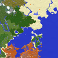

# Minimap Plus

Turns Horizon's minimap on and shapes it: corner, size, zoom keys, a big-map key, turning and round or square.

**Version** 1.0.0 · **Game** 26.3 · **Hook-point API 1** · **Licence** MIT · [Source](https://github.com/pxdns/horizon-mods-lib/tree/main/mods/minimap-plus) · [Releases](https://github.com/pxdns/horizon-mods-lib/releases?q=minimap-plus)

## Use it

| Key | Default | What it does |
|---|---|---|
| Big map | `M` | Press to blow the minimap up to its largest size and widest view, press again to go back |
| Zoom in | `=` | Fewer blocks per map pixel |
| Zoom out | `-` | More blocks per map pixel |

The settings page picks the corner, the size, the starting zoom, whether the map turns with you and whether it is round. `/minimap` hides or shows it.

Switch it on or off in **Options → Mods → Minimap Plus**; its settings page has one button per option. Install steps are in
[Install a mod](../install.md).

## How it is built

- Hooks: `native_key`, `native_minimap`, `native_mods`, `native_settings`, `native_settings_click`, `native_command`.
- Logic and tests: `mods/minimap-plus/mixins/minimap_plus/runtime.rs`.
- Pinned: Horizon `ba6344a`, horizon-mixins `d9c83d7`, `hooks: 1`.

## Credit

Ported from **Xaero's Minimap and Xaero's World Map (the map display)** (independent implementation, no upstream code); an independent implementation, with no upstream code or art. See [Credits](../credits.md)
and [Licensing](../licensing.md).
