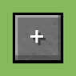

# Multi Key Bindings

More than one key for the same action.

**Version** 1.0.0 · **Game** 26.3 · **Pinned to Horizon ba6344a, reads game state** · **Licence** MIT · [Source](https://github.com/pxdns/horizon-mods-lib/tree/main/mods/multi-key-bindings) · [Releases](https://github.com/pxdns/horizon-mods-lib/releases?q=multi-key-bindings)

## Use it

| Command | What it does |
|---|---|
| `/multikey add <action> <key>` | Also drives `<action>` (for example `forward`, `jump`, `inventory`) from `<key>` (`up`, `space`, `mouse.4`, `left.control`) |
| `/multikey remove <action> [key]` | Removes one extra key of an action, or all of them |
| `/multikey list` | Shows the extra keys |

The key you add works as well as the action's own key, held or pressed, wherever the action works. The first key stays on the Key Binds page; extra ones are managed here.

| Option | Default |
|---|---|
| Say in chat when an extra key changes | on |

Switch it on or off in **Options → Mods → Multi Key Bindings**; its settings page has one button per option. Install steps are in
[Install a mod](../install.md).

## How it is built

- Hooks: `keybinds::KeyBinds::translate_all`, `keybinds::KeyBinds::translate_mouse_all`, `native_tick`, `native_command`, `native_mods`, `native_settings`, `native_settings_click`.
- Logic and tests: `mods/multi-key-bindings/mixins/multi_key_bindings/runtime.rs`.
- Pinned: Horizon `ba6344a`, horizon-mixins `d9c83d7`. It reads fields of the game that are not part of the stable hook-point contract, so it must be re-checked when Horizon changes them.

## Credit

Ported from **Multi Key Bindings (multi-key-bindings)** (independent implementation from the mod's public description; no upstream code or assets); an independent implementation, with no upstream code or art. See [Credits](../credits.md)
and [Licensing](../licensing.md).
