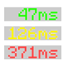

# Ping View

Shows your ping to the server: the latest reply, the average of the last 20 and the best and worst.

**Version** 1.0.0 · **Game** 26.3 · **Pinned to Horizon ba6344a, reads game state** · **Licence** MIT · [Source](https://github.com/pxdns/horizon-mods-lib/tree/main/mods/ping-view) · [Releases](https://github.com/pxdns/horizon-mods-lib/releases?q=ping-view)

## Use it

| Command | What it does |
|---|---|
| `/ping` | Hides or shows the ping box |

On a server, a box shows your ping (the last reply) with the average of the last 20 replies and the best and worst, coloured green, yellow or red. On single player there are no pings and nothing shows.

| Option | Default |
|---|---|
| Shown | on |
| Average of the last 20 | on |
| Best and worst | off |
| Colour by ping | on |

Switch it on or off in **Options → Mods → Ping View**; its settings page has one button per option. Install steps are in
[Install a mod](../install.md).

## How it is built

- Hooks: `debug_chart::SampleLogger::log`, `native_frame`, `native_hud`, `native_command`, `native_mods`, `native_settings`, `native_settings_click`.
- Logic and tests: `mods/ping-view/mixins/ping_view/runtime.rs`.
- Pinned: Horizon `ba6344a`, horizon-mixins `d9c83d7`. It reads fields of the game that are not part of the stable hook-point contract, so it must be re-checked when Horizon changes them.

## Credit

Ported from **Ping View (pingview)** (see the upstream project); an independent implementation, with no upstream code or art. See [Credits](../credits.md)
and [Licensing](../licensing.md).
