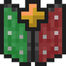

# Shield Statuses

Your shield's state as a coloured line: ready, blocking, or disabled with the seconds left.

**Version** 1.0.0 · **Game** 26.3 · **Pinned to Horizon ba6344a, reads game state** · **Licence** MIT · [Source](https://github.com/pxdns/horizon-mods-lib/tree/main/mods/shield-statuses) · [Releases](https://github.com/pxdns/horizon-mods-lib/releases?q=shield-statuses)

## Use it

Nothing to press: while you carry a shield a box in the top-right corner says `Shield: ready` (green), `Shield: blocking` (aqua) or `Shield: disabled 3.5 s` (red) after an axe disables it. `/shield` hides or shows it.

| Option | Default |
|---|---|
| Shown | on |
| Hide when ready | off |

Switch it on or off in **Options → Mods → Shield Statuses**; its settings page has one button per option. Install steps are in
[Install a mod](../install.md).

## How it is built

- Hooks: `native_hud`, `native_command`, `native_mods`, `native_settings`, `native_settings_click`.
- Logic and tests: `mods/shield-statuses/mixins/shield_statuses/runtime.rs`.
- Pinned: Horizon `ba6344a`, horizon-mixins `d9c83d7`. It reads fields of the game that are not part of the stable hook-point contract, so it must be re-checked when Horizon changes them.

## Credit

Ported from **Shield Statuses (shieldstatus)** (see the upstream project); an independent implementation, with no upstream code or art. See [Credits](../credits.md)
and [Licensing](../licensing.md).
