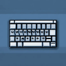

# VisualKeys

An on-screen keyboard that shows what every key is bound to and which keys are free.

**Version** 1.0.0 · **Game** 26.3 · **Pinned to Horizon ba6344a, reads game state** · **Licence** MIT · [Source](https://github.com/pxdns/horizon-mods-lib/tree/main/mods/visual-keys) · [Releases](https://github.com/pxdns/horizon-mods-lib/releases?q=visual-keys)

## Use it

| Key | Default | What it does |
|---|---|---|
| Show keyboard | `F9` | Shows or hides the keyboard in the bottom-right corner |

Each key is coloured by the category of the action bound to it (movement green, gameplay red, inventory blue, multiplayer purple, other gold), dark when it has no binding, and bright while you hold it. `/keyboard` shows or hides it, `/keyboard free` lists the letters, digits and function keys with no binding, and `/keyboard q` says what `q` does.

| Option | Default |
|---|---|
| Show the keyboard | off |

Switch it on or off in **Options → Mods → VisualKeys**; its settings page has one button per option. Install steps are in
[Install a mod](../install.md).

## How it is built

- Hooks: `native_hud`, `native_key`, `native_command`, `native_mods`, `native_settings`, `native_settings_click`.
- Logic and tests: `mods/visual-keys/mixins/visual_keys/runtime.rs`.
- Pinned: Horizon `ba6344a`, horizon-mixins `d9c83d7`. It reads fields of the game that are not part of the stable hook-point contract, so it must be re-checked when Horizon changes them.

## Credit

Ported from **VisualKeys (visualkeys)** (independent implementation from the mod's public description; no upstream code or assets); an independent implementation, with no upstream code or art. See [Credits](../credits.md)
and [Licensing](../licensing.md).
